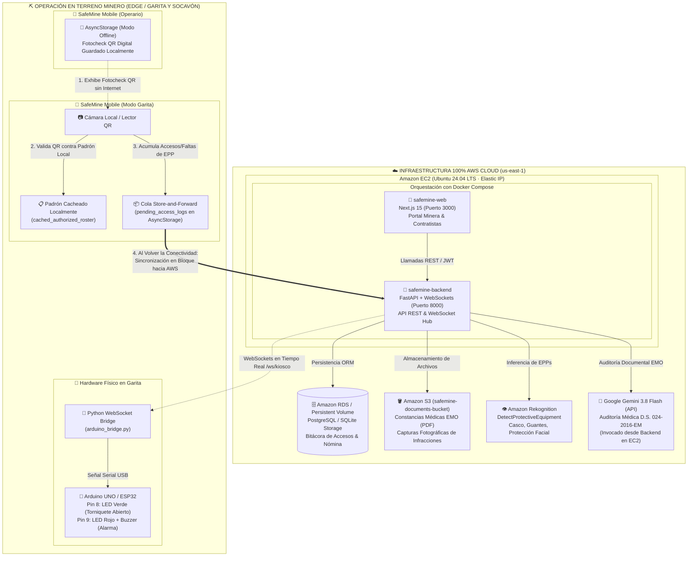

# SafeMine AI — Arquitectura 100% AWS Cloud, Despliegue con Docker y Sincronización Offline-First en Minería

> **Documento Oficial de Infraestructura Cloud y Continuidad Operativa en Terreno Minero**  
> Proyecto: **SafeMine AI** · Seguridad y Salud Ocupacional (SSO)  
> Región Cloud: **AWS us-east-1 (N. Virginia)**  
> Arquitectura: **100% AWS Cloud Native + Edge Offline Store-and-Forward**

---

## 🏛️ 1. Arquitectura 100% AWS Cloud + Edge Offline Minero

SafeMine AI implementa una **infraestructura unificada alojada en Amazon Web Services (AWS)**, eliminando intermediarios como Vercel o Render, complementada con una **arquitectura resiliente Offline-First (Store-and-Forward)** diseñada para soportar cortes de señal satelital en socavones y garitas remotas de los Andes peruanos.



---

### Componentes de la Solución

#### A. Infraestructura Central en AWS (`us-east-1`)
1. **Amazon EC2 (Ubuntu 24.04 LTS + Docker Compose)**:
   - Instancia `t3.small` o `t2.medium` vinculada a una **Elastic IP (IPv4 fija)**.
   - Contenedor **`safemine-web`** (Next.js 15, puerto `3000`): Consola administrativa corporativa para la Minera y las empresas contratistas.
   - Contenedor **`safemine-backend`** (FastAPI, puerto `8000`): Motor de autenticación JWT (HS256 criptográfico), endpoints REST de acreditación y servidor de WebSockets en `/ws/kiosco`.
2. **Amazon RDS / Volumen Persistente**:
   - Persistencia relacional de usuarios, convocatorias, operarios y registros de acceso (`AccessLog`).
3. **Amazon S3 (`safemine-documents-bucket`)**:
   - Repositorio seguro de certificados de aptitud médica (EMO) en formato PDF e imágenes de evidencia capturadas en garita.
4. **Amazon Rekognition (`DetectProtectiveEquipment`)**:
   - Servicio cloud de visión por computadora para la inspección automatizada de EPPs obligatorios: Casco (`HEAD_COVER`), Guantes (`HAND_COVER`) y Lentes/Protección facial (`FACE_COVER`) con confianza $\ge 80\%$.
5. **Motor Cognitivo Documental (Google Gemini IA)**:
   - Invocado de manera segura desde el backend en EC2 para analizar certificados médicos bajo el **Anexo 16 del D.S. 024-2016-EM**, validando autenticidad, identidad del titular y dictamen de aptitud (APTO).

#### B. Arquitectura Offline-First en Terreno Minero (Sin Cobertura)
1. **Fotocheck QR Offline del Trabajador**:
   - El operario almacena su credencial acreditada en la memoria segura del smartphone (`AsyncStorage`). No requiere señal telefónica ni datos móviles para abrir su código QR ante el personal de seguridad en socavón.
2. **Padrón Cacheado en Garita (`cached_authorized_roster`)**:
   - La garita descarga el padrón de trabajadores vigentes mediante el endpoint `GET /api/kiosco/authorized-roster` cuando dispone de conexión. Si se interrumpe el enlace satelital, la cámara de garita valida al instante el Código QR contra su memoria local sin emitir llamadas a la nube.
3. **Cola Store-and-Forward (`pending_access_logs`)**:
   - Durante un corte de señal, cada inspección (concedida o rechazada por falta de EPP) se almacena en una cola local protegida con su marca de tiempo (`timestamp`).
   - Al restablecerse la conectividad, el vigilante pulsa **"Recuperar Señal y Sincronizar con AWS"**, transmitiendo todos los eventos acumulados al endpoint `POST /api/kiosco/sync-offline-logs`. El backend en AWS EC2 inserta los registros en la base de datos, incrementa automáticamente las faltas de EPP en el legajo del operario y emite una alerta por WebSockets al panel de la Minera y al Arduino.

---

## 🚀 2. Guía Paso a Paso de Despliegue en AWS (Comandos Exactos)

Sigue estos pasos para desplegar toda la infraestructura en AWS antes de la presentación:

### Paso 1: Configurar IAM y Bucket S3 en AWS Console

1. Inicia sesión en la **Consola de AWS** en la región **`us-east-1` (N. Virginia)**.
2. Ve a **S3** $\rightarrow$ Haz clic en **Create bucket**:
   - Bucket name: `safemine-documents-bucket` (o un nombre único, ej. `safemine-docs-2026`).
   - Bloqueo de acceso público: Mantener activado.
   - Haz clic en **Create bucket**.
3. Ve a **IAM** $\rightarrow$ **Users** $\rightarrow$ **Create user** (ej. `safemine-ec2-agent`):
   - Asocia directamente las siguientes políticas de permisos gestionadas por AWS:
     - `AmazonRekognitionReadOnlyAccess`
     - `AmazonS3FullAccess`
   - Ve a la pestaña **Security credentials** del usuario $\rightarrow$ **Create access key** $\rightarrow$ Selecciona **Command Line Interface (CLI)**.
   - Guarda tu `AWS_ACCESS_KEY_ID` y `AWS_SECRET_ACCESS_KEY`.

---

### Paso 2: Lanzar la Instancia AWS EC2

1. Ve a **EC2** $\rightarrow$ **Launch instance**:
   - **Name**: `SafeMine-Production-Server`
   - **AMI**: Ubuntu Server 24.04 LTS (HVM), SSD Volume Type (64-bit x86).
   - **Instance type**: `t3.small` (Recomendado: 2 vCPU, 2 GiB RAM) o `t2.medium`.
   - **Key pair**: Crea o selecciona tu par de llaves `.pem` (ej. `safemine-key.pem`).
2. **Network settings / Security Group** (Crear `safemine-sg`):
   Configura las siguientes reglas de entrada (**Inbound Security Group Rules**):
   
   | Tipo | Protocolo | Puerto | Origen (Source) | Descripción |
   | :--- | :--- | :--- | :--- | :--- |
   | **SSH** | TCP | `22` | `0.0.0.0/0` (o tu IP) | Administración remota por terminal |
   | **Custom TCP** | TCP | `3000` | `0.0.0.0/0` | **SafeMine Web Console (Next.js)** |
   | **Custom TCP** | TCP | `8000` | `0.0.0.0/0` | **FastAPI Backend REST & WebSockets** |

3. Haz clic en **Launch instance**.
4. *(Recomendado)* Asigna una **Elastic IP** a la instancia en **EC2 $\rightarrow$ Network & Security $\rightarrow$ Elastic IPs** para que la dirección IP pública no cambie al reiniciar.

---

### Paso 3: Conectar por SSH e Instalar Docker en EC2

Desde tu máquina local (PowerShell o Terminal Linux/macOS):

```bash
# Otorgar permisos correctos a tu llave (en Linux/macOS)
chmod 400 safemine-key.pem

# Conectarte por SSH a tu instancia AWS EC2
ssh -i safemine-key.pem ubuntu@<EC2_PUBLIC_IP>
```

Una vez dentro de la terminal de **Ubuntu 24.04 en AWS EC2**, ejecuta:

```bash
# 1. Actualizar el sistema e instalar utilidades básicas
sudo apt-get update && sudo apt-get upgrade -y
sudo apt-get install -y git curl ca-certificates gnupg lsb-release

# 2. Instalar el motor oficial de Docker
sudo install -m 0755 -d /etc/apt/keyrings
curl -fsSL https://download.docker.com/linux/ubuntu/gpg | sudo gpg --dearmor -o /etc/apt/keyrings/docker.gpg
sudo chmod a+r /etc/apt/keyrings/docker.gpg

echo \
  "deb [arch=$(dpkg --print-architecture) signed-by=/etc/apt/keyrings/docker.gpg] https://download.docker.com/linux/ubuntu \
  $(. /etc/os-release && echo "$VERSION_CODENAME") stable" | \
  sudo tee /etc/apt/sources.list.d/docker.list > /dev/null

sudo apt-get update
sudo apt-get install -y docker-ce docker-ce-cli containerd.io docker-buildx-plugin docker-compose-plugin

# 3. Dar permisos al usuario ubuntu para ejecutar Docker sin sudo
sudo usermod -aG docker ubuntu
newgrp docker

# 4. Verificar instalación de Docker y Docker Compose
docker --version
docker compose version
```

---

### Paso 4: Clonar el Repositorio y Configurar Variables de Entorno

```bash
# 1. Clonar el repositorio del proyecto
git clone https://github.com/<tu-usuario>/SafeMine.git
cd SafeMine

# 2. Configurar las variables del Backend
nano backend/.env
```

Pega el siguiente contenido en `backend/.env` reemplazando con tus credenciales reales:

```env
# Base de Datos Relacional
DATABASE_URL=sqlite:///./safemine.db

# Clave secreta para tokens JWT
JWT_SECRET_KEY=safemine-jwt-production-secret-2026-ec2

# Desactivar simulación para operar con la nube de AWS y Gemini
USE_MOCK_AI=false
USE_MOCK_AWS=false

# Google Gemini API
GEMINI_API_KEY=AIzaSy...Tu_Api_Key_De_Google_Studio...
GEMINI_MODEL=gemini-3.8-flash

# AWS Rekognition y S3
AWS_ACCESS_KEY_ID=AKIA...Tu_Access_Key...
AWS_SECRET_ACCESS_KEY=wJalr...Tu_Secret_Key...
AWS_REGION=us-east-1
AWS_S3_BUCKET=safemine-documents-bucket
MIN_EPP_CONFIDENCE=80.0
```

> Guarda con `Ctrl + O`, `Enter` y sal con `Ctrl + X`.

```bash
# 3. Configurar variables del Frontend Web apuntando a la IP pública del EC2
nano web/.env.local
```

Pega:

```env
NEXT_PUBLIC_API_URL=http://<EC2_PUBLIC_IP>:8000
NEXT_PUBLIC_WS_URL=ws://<EC2_PUBLIC_IP>:8000/ws/kiosco
```

---

### Paso 5: Construir y Levantar los Contenedores con Docker Compose

Ejecuta en la raíz del proyecto (`SafeMine/`):

```bash
# Construir las imágenes y levantar los servicios en segundo plano
docker compose up -d --build
```

Verifica el estado de los contenedores:

```bash
docker compose ps
docker compose logs -f
```

Ambos servicios deben figurar en estado `running (healthy)`:
- `safemine-backend` en `http://<EC2_PUBLIC_IP>:8000`
- `safemine-web` en `http://<EC2_PUBLIC_IP>:3000`

---

### Paso 6: Conectar la App Móvil y el Arduino a AWS EC2

#### 1. Configurar la App Móvil (`mobile/`)
En tu máquina de desarrollo o en el archivo `mobile/.env`:

```env
EXPO_PUBLIC_API_URL=http://<EC2_PUBLIC_IP>:8000
```

Inicia la app móvil:

```bash
cd mobile
npm install
npx expo start
```
Escanea el código QR desde tu teléfono físico con **Expo Go**.

#### 2. Conectar el Hardware Arduino Físico a AWS EC2
Conecta tu Arduino por USB a la laptop del aula de clases y ejecuta el puente apuntando a la IP de AWS EC2:

```powershell
cd iot-arduino
pip install -r requirements.txt
python arduino_bridge.py --port COM3 --ws ws://<EC2_PUBLIC_IP>:8000/ws/kiosco
```

El puente se conectará a AWS EC2 por WebSockets. Cada vez que alguien pase por la garita móvil, el servidor en la nube enviará la señal instantáneamente a tu microcontrolador físico por USB.

---

## 💡 Alternativa: Despliegue de `web/` en AWS Amplify (Opcional)

Si el profesor solicita desacoplar el frontend web del servidor EC2 para usar un servicio administrado de AWS:

1. Ve a **AWS Amplify Console** en `us-east-1` $\rightarrow$ **Host web app**.
2. Conecta tu repositorio de GitHub y selecciona la carpeta base `/web`.
3. En **Environment variables**, agrega:
   - `NEXT_PUBLIC_API_URL`: `http://<EC2_PUBLIC_IP>:8000`
   - `NEXT_PUBLIC_WS_URL`: `ws://<EC2_PUBLIC_IP>:8000/ws/kiosco`
4. Haz clic en **Save and Deploy**. Amplify compilará y publicará la consola web en una URL global de alta disponibilidad (`https://main.xxxx.amplifyapp.com`).

---

## 🧪 3. Guión de Demostración "Corte de Internet en Mina" para la Exposición

Sigue este guión de 4 pasos para impresionar al profesor demostrando la resiliencia **Offline-First Store-and-Forward**:

```
                              GUIÓN DE DEMOSTRACIÓN EN VIVO
       ┌────────────────────────────────────────────────────────────────────────┐
       │ 1. Estado Online Normal con AWS EC2                                    │
       │    • Abrir SafeMine Web en http://<EC2_PUBLIC_IP>:3000                 │
       │    • Probar conexión WebSocket viva (indicador verde "WS Garita").     │
       ├────────────────────────────────────────────────────────────────────────┤
       │ 2. Simulación de Corte de Señal Satelital en Mina                     │
       │    • En SafeMine Mobile, pulsar "Simular Corte de Señal".              │
       │    • Poner el celular en Modo Avión (cero conexión a Internet).        │
       │    • El encabezado cambia a "Modo Garita Offline (Sin Señal)".        │
       ├────────────────────────────────────────────────────────────────────────┤
       │ 3. Inspección 100% Offline con Fotocheck y Cámara                     │
       │    • Operario exhibe su Fotocheck QR guardado en AsyncStorage.         │
       │    • La garita escanea el QR y valida al instante contra el padrón     │
       │      local en memoria (Carlos Mendoza = OK / Jorge Quispe = Rechazado).│
       │    • Simular falta de EPP: Semáforo ROJO en pantalla.                  │
       │    • El contador muestra: "1 registro en cola local esperando señal".  │
       ├────────────────────────────────────────────────────────────────────────┤
       │ 4. Restablecimiento de Cobertura y Sincronización Masiva              │
       │    • Desactivar Modo Avión y pulsar "Recuperar Señal y Sincronizar".   │
       │    • Todos los registros acumulados viajan en lote a AWS RDS.          │
       │    • Al instante, en la Web de la Minera (EC2) aparece la infracción   │
       │      y el Arduino físico pita mediante WebSockets.                     │
       └────────────────────────────────────────────────────────────────────────┘
```

### Paso 1: Demostrar Operación Online con AWS
1. Abre en tu navegador [http://<EC2_PUBLIC_IP>:3000](http://<EC2_PUBLIC_IP>:3000) (SafeMine Web alojado en AWS EC2).
2. Abre la consola de la Minera y muestra la tabla de operarios limpia.
3. En la app móvil, muestra que el badge indica `WS Garita` conectado al servidor en AWS.

### Paso 2: Provocar el "Corte de Señal en Mina"
1. Explica al profesor: *"En este momento la unidad minera pierde el enlace satelital por condiciones climáticas adversas en la cordillera"*.
2. En la app móvil (pantalla de Garita), presiona el botón **"Simular Corte de Señal"** (o desactiva el Wi-Fi/activa Modo Avión).
3. La interfaz cambiará a un banner ámbar:  
   **"📡 Modo Garita Offline (Sin Señal)"** con el mensaje: *"Operando con padrón local en memoria"*.

### Paso 3: Operación en Modo Offline (Inspección y Encolado Local)
1. **Validación del Fotocheck QR Offline**:
   - Escanea el QR del operario acreditado (Carlos Mendoza).
   - Muestra cómo la app reconoce su nombre, cargo y aptitud médica **sin enviar ningún paquete a internet**, validándolo directamente contra `cached_authorized_roster`.
2. **Registro de Infracción de EPP en Terreno**:
   - Pulsa *"Simular: Sin Guantes ni Protección Facial"*.
   - La pantalla se enciende en **Semáforo ROJO** y muestra el badge:  
     `"Evento guardado en cola local (Store-and-Forward: 1 pendiente hacia AWS)"`.
   - Muestra el contador en el banner:  
     `"Modo Offline: 1 registro(s) en cola local esperando señal hacia AWS"`.
3. Repite con otro operario no acreditado para acumular 2 o más registros en la cola.

### Paso 4: Reconexión y Sincronización Automática con AWS
1. Reactiva el Wi-Fi en el smartphone (o presiona *"Conectar a Online"*).
2. Señala el botón verde destacado: **"⚡ Recuperar Señal y Sincronizar con AWS (2)"**.
3. Presiónalo:
   - Se enviará el lote acumulado a `POST /api/kiosco/sync-offline-logs`.
   - La cola local se limpia a 0 registros.
   - Aparece la alerta: *"¡Sincronización Exitosa con AWS! 2 eventos acumulados durante el corte de señal fueron transferidos a AWS RDS y transmitidos en tiempo real por WebSockets"*.
4. **Verificación en Vivo frente al Profesor**:
   - Voltea a la pantalla de la laptop en la Web de la Minera (puerto 3000 en AWS):  
     Refresca y muestra cómo las faltas de EPP y notas de auditoría ocurridas durante el corte ya están grabadas en la base de datos de AWS con su fecha y hora exactas.
   - En la consola del Arduino, muestra cómo el comando serial sonó al recibirse el evento por WebSockets.

---

## 📊 4. Resumen de Endpoints del Mecanismo Store-and-Forward

| Método | Endpoint | Alcance | Descripción Técnica |
| :--- | :--- | :--- | :--- |
| **GET** | `/api/kiosco/authorized-roster` | Garita $\rightarrow$ AWS | Descarga el padrón compacto de trabajadores autorizados (`worker_id`, `dni`, `is_authorized`, `required_epps`, `qr_token`) para cachear en `AsyncStorage`. |
| **POST** | `/api/kiosco/sync-offline-logs` | Garita $\rightarrow$ AWS | Recibe un arreglo de eventos acumulados sin conexión (`status`, `missing_items`, `timestamp`). Inserta en `AccessLog`, suma a `faltas_epp_count` y notifica a WebSockets. |
| **POST** | `/api/vision/verify-qr` | Garita $\rightarrow$ AWS | Verificación online en tiempo real de Códigos QR cuando hay señal satelital disponible. |
| **POST** | `/api/vision/verify-epp` | Garita $\rightarrow$ AWS | Verificación online de fotograma con el modelo `DetectProtectiveEquipment` de AWS Rekognition. |
| **WS** | `/ws/kiosco` | AWS $\rightarrow$ Arduino/Web | WebSocket bidireccional que difunde instantáneamente las aperturas de puerta o alarmas a los paneles y al hardware físico. |

